# text_layover

**Removing the text sellers add on top of listing photos (prices, phone numbers, captions, watermarks, stickers)
without touching the photograph underneath.**

<p align="center">
  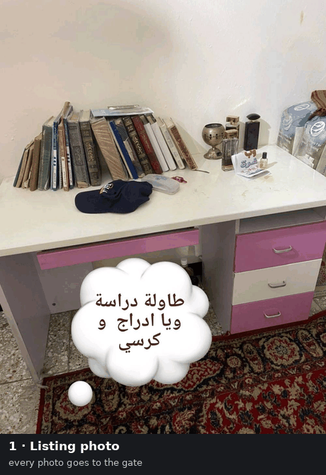
</p>

- **Quality:** gate + worker 92.2% accurate on a 219-photo labelled test set; the final configuration passed human
  review on 109 of 115 photos (95%); on a later random sample of new listing photos, 79% clean and 9% with minor flaws.
- **Speed:** 21 s median per erased photo on one RTX A6000; the other 95% of photos need one 2-second Gemini call
  and no GPU.
- **Memory:** the whole eraser (FLUX.1-Fill in NF4, SAM 2.1, CRAFT, LaMa) peaks at 13.4 GiB.
- **Cost overhead:** +34% on the Gemini side over the text call the marketplace already makes on every photo;
  +114% including the GPU at a typical A6000 rental price.

**The illustrated walkthrough is [`docs/index.html`](docs/index.html)** (served by GitHub Pages): the problem, every
stage with the photo that made it necessary, NF4, and speed, usage and cost on an RTX A6000.

Contents: [How it works](#how-it-works) · [Why each stage is there](#why-each-stage-is-there) ·
[NF4](#nf4-flux-in-a-quarter-of-the-memory) · [Samples](#samples) · [Results](#results) ·
[Speed, usage and cost](#speed-usage-and-cost-on-an-rtx-a6000) · [Next steps](#next-steps) · [Running it](#running-it) ·
[Repository layout](#repository-layout) · [What was tried and rejected](#what-was-tried-and-rejected) ·
[Privacy and licences](#privacy-and-licences) · [History](#history-the-first-pipeline-august-2026)

---

## The problem

Sellers type the price, the phone number and the shop's name straight onto their listing photos. There is no
layered original to go back to: the overlay *is* the image now. Re-shooting is impossible, so the only way to a clean
photo is to reconstruct what the overlay covers.

Three things make it hard:

- **Not all text is an overlay.** Goods have writing on them: labels, packaging, signs, licence plates, screens. A
  text detector cannot tell the two apart (CRAFT fires on 85 of 86 photos with no overlay at all). Only a model that
  understands the picture can, so a vision-language model decides *what* was added, and pixel models decide *where
  exactly*.
- **The overlay hides its own extent.** Text usually sits on a chip, band or translucent panel; a mask around the
  letters leaves a rim behind.
- **Repainting too much is as bad as too little.** A large hole invites the inpainter to invent (fake text, objects
  that were never there). The mask must be tight, and anything that changes the photo outside it is a failure.

## How it works

Every photo gets one cheap Gemini call. Only photos with something to do get a second call, and only photos with text
added on top of a real photograph go to the GPU. All calls use gemini-3.5-flash-lite, temperature 0, thinking LOW, a
strict JSON schema and the flex tier.

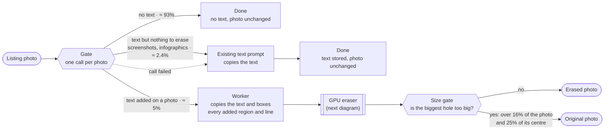

- **Gate.** Answers `eligible` (does the picture carry digital text: overlays, infographics, screenshots; the
  meaning of the field the marketplace already stores) and `removal` (was text added *on top of a real photograph*,
  so that removing it leaves a hole to reconstruct). Text on its own band beside the photo, infographics, posters,
  screenshots and app chrome are eligible but not removable. Its whole reply is about 12 tokens.
- **Worker.** Copies the text and returns one box per added region, plus a box per line, whether the text sits on a
  carrier (chip, band, panel), and whether a region is real-world writing (`physically_in_scene`), which is then
  protected.
- **Existing text prompt.** The marketplace's own text-extraction call, unchanged. Text-only photos go to it rather
  than to the worker: the worker would box every line of a screenshot only for the boxes to be thrown away, at about
  six times the cost.
- If the gate or the worker fails, the photo falls back to the existing call. If that fails too, the fields come back
  unknown, never as a fake "no text".

The prompt texts are not published. **[`gemini/README.md`](gemini/README.md) explains what each prompt asks, every
field it returns and how the eraser uses it**, with token usage per call and the prompt history. Routing, retries and
fallbacks live in [`gemini/tl_gemini.py`](gemini/tl_gemini.py).

### Inside the GPU eraser

One process holds every model on one GPU (FLUX.1-Fill + object-removal LoRA in 4-bit, SAM 2.1, CRAFT, LaMa) and serves
photos one at a time. Peak memory 13.4 GiB.

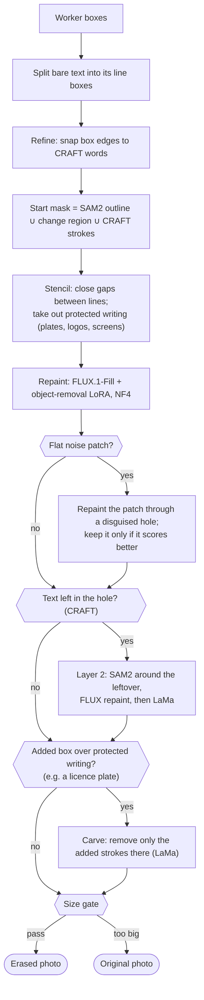

| Step | What it fixes | How often (October tests) |
|---|---|---|
| Line split | Gemini sometimes merges separate lines into one box; SAM2 then outlines the object behind them | every bare-text region |
| Refine | Gemini's coordinates drift by about a line on 3–8% of regions; edges get snapped to the detected words | always |
| Start mask | SAM2 finds the carrier's shape; CRAFT finds strokes SAM2 misses; the change region catches translucent panels | always |
| Stencil, halo 0 | The mask hugs the overlay; no extra margin (a margin only gives the model more room to invent) | always |
| Repaint | FLUX.1-Fill-dev with the `objectRemovalv1_r32` LoRA, guidance 30, 30 steps, a positive "plain empty surface" prompt; blended in through an outward-only feather | always (98% of GPU time) |
| Patch fix | A flat, grainy rectangle where the hole was (tone and grain off on smooth surfaces) | ~6% flagged, ~2% fixed |
| Layer 2 | Text or objects FLUX invented inside the hole: FLUX repaints them, then LaMa | ~16–20% |
| Carve | Added writing on top of a plate: only its strokes are removed (LaMa fill), the plate stays | ~1% |
| Size gate | Holes too big to fill honestly: ship the original instead | ~2% held |

Every number and threshold here was fixed by a measurement;
[`eraser/tl/pipeline/config.py`](eraser/tl/pipeline/config.py) and the files under [`eraser/tl/`](eraser/tl) carry the
reasons as comments.

## Why each stage is there

Each stage was added after a specific failure on real listings. For each one: the photo that showed the problem,
without the stage and then with it. Red = mask, magenta = worker box, green = protected writing. Phone numbers and a
marketplace watermark are pixelated.

**01 · Gate.** Most text should not be erased. Three photos, three answers, each the gate's own reply from the test
set: a price typed on a photo (`eligible`, `removal: 1`, erase); an advert built around its words (`eligible`,
`removal: 0`, copy the text and keep the picture); a real "for sale" sign (`removal: 0`, not eligible, nothing to do).

<p>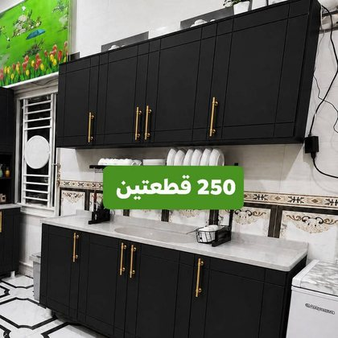  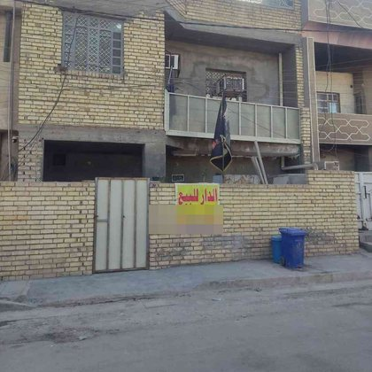</p>

**02 · Line split.** One box around three lines makes SAM2 outline the gate behind them, and FLUX replaces the gate
with a wall. Line boxes keep SAM2 on the letters. *(original · one box: mask · result · line boxes: mask · result)*

<p>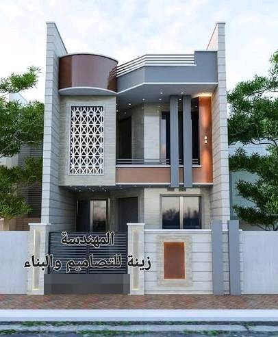 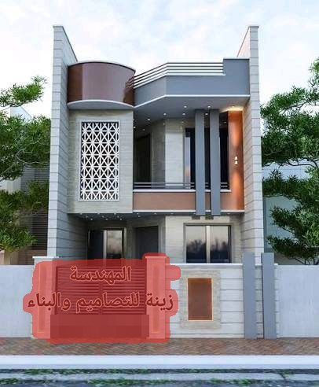 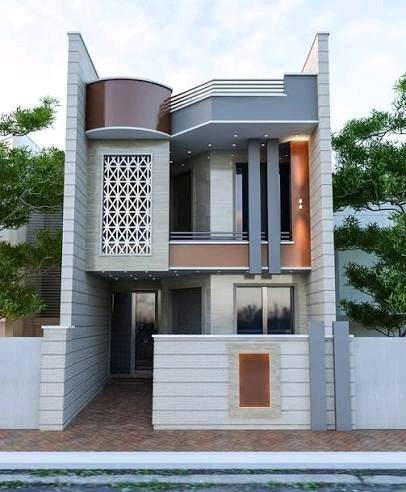 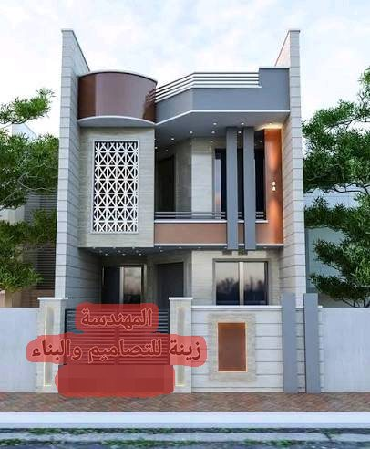 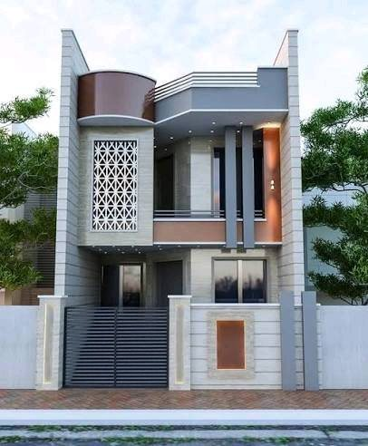</p>

**03 · Refine and align.** Gemini's boxes drift by about a line on 3–8% of regions; letters at the edge survive.
Snapping the boxes to CRAFT's words fixes it. *(original · as returned · result · snapped · result)*

<p>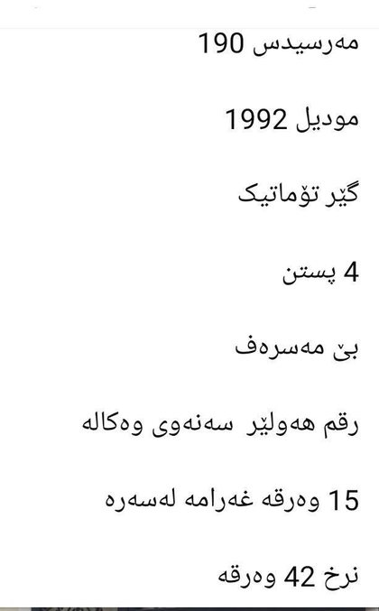 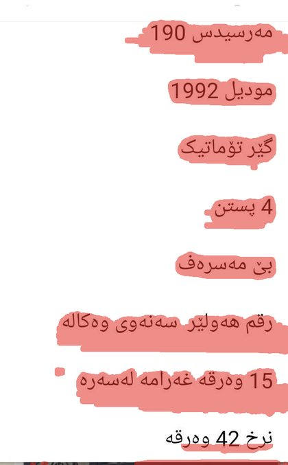 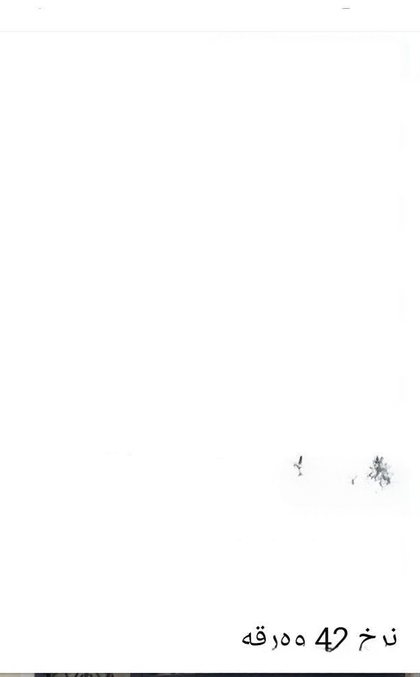 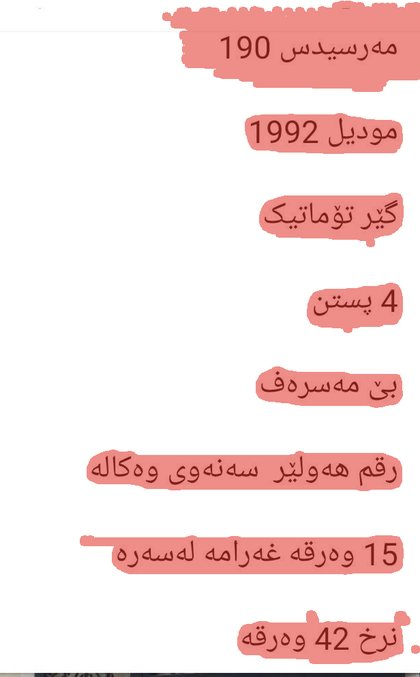 </p>

**04 · CRAFT strokes in the starting mask.** SAM2 and the change region miss thin strokes on a busy wall, and a ghost
line of text survives. *(original · SAM2 + change · result · + CRAFT · result)*

<p>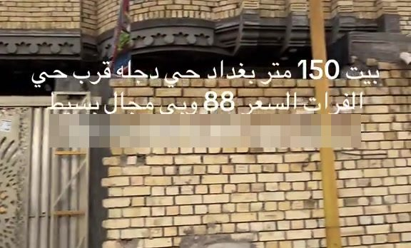 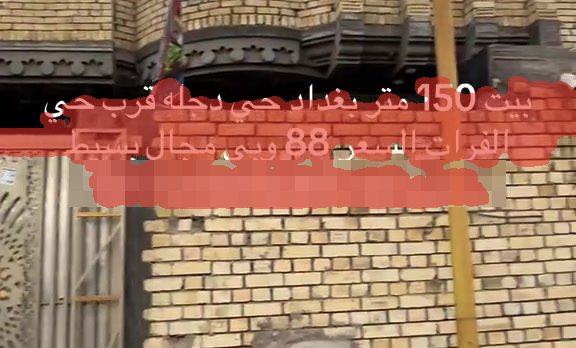 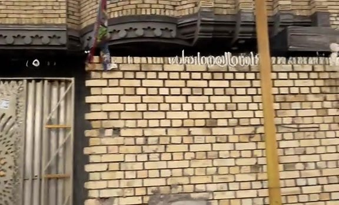 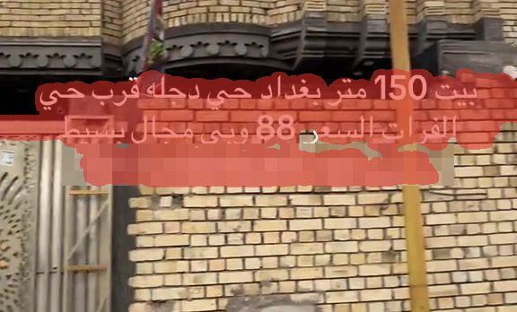 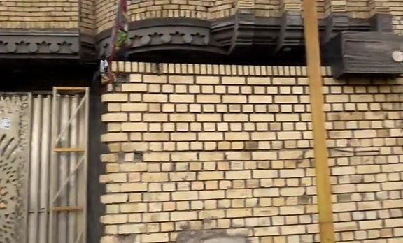</p>

**05 · Protect real-world writing.** The worker marks the product's own writing (here a scale's display) as
`physically_in_scene`; it is cut out of the stencil and restored after every repaint. *(boxes · stencil · final)*

<p>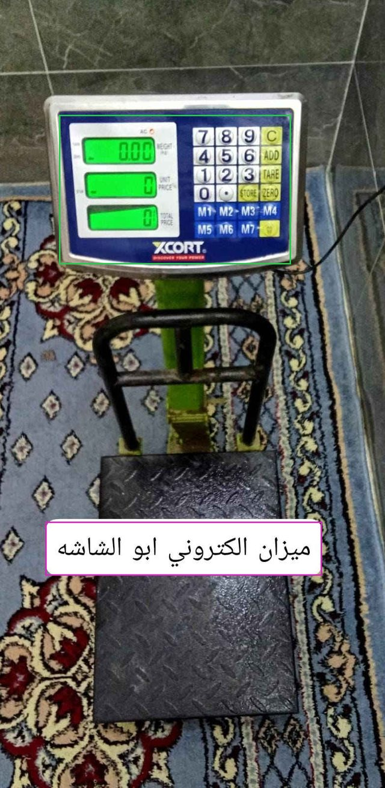 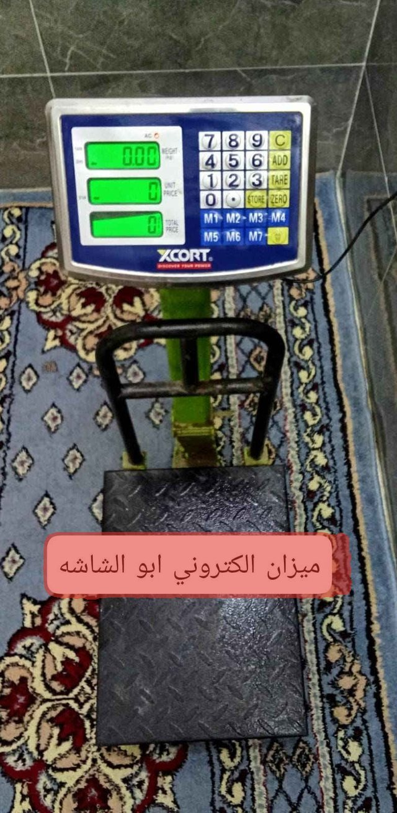 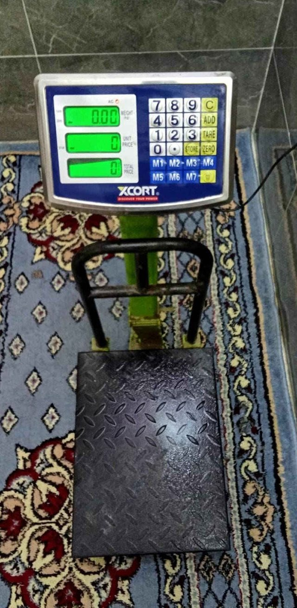</p>

**06 · Outward-only feather.** A Gaussian-feathered mask also softens inward, so a faint copy of the text survives
in its own colour (6–8% of the original). The brighter of the mask and its blur keeps the inside at full strength.
*(original · Gaussian feather · outward-only)*

<p>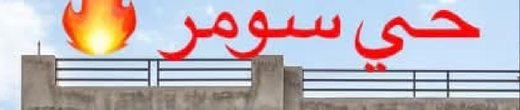  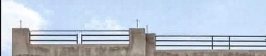</p>

**07 · Patch fix.** On smooth sky the first repaint can come back as a grainy rectangle in the chip's shape; it is
repainted through a hole with a randomised edge and kept only if it scores better. *(original, watermark pixelated ·
first repaint · fixed)*

<p> 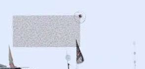 </p>

**08 · Layer 2.** FLUX fills a hole with what it expects to see there: over an oven's dial, it writes new dial
numbers. CRAFT finds them, SAM2 outlines what was invented, and that area is repainted inside the original stencil.
*(original, phone pixelated · first repaint · after layer 2)*

<p>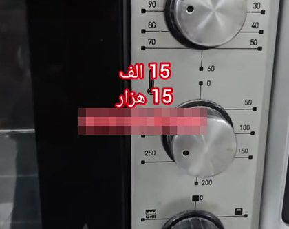 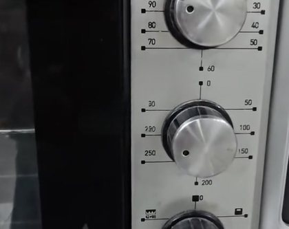 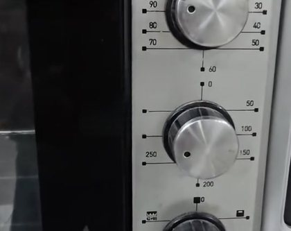</p>

**09 · Size gate.** When most of the product would have to be invented, ship the original. Here six lines of text
cover most of a water-filter system (the hole is 39% of the photo and 83% of its centre); the repaint looks
plausible, but every housing in it was invented. *(original, numbers pixelated · mask · the repaint that was never
shipped)*

<p>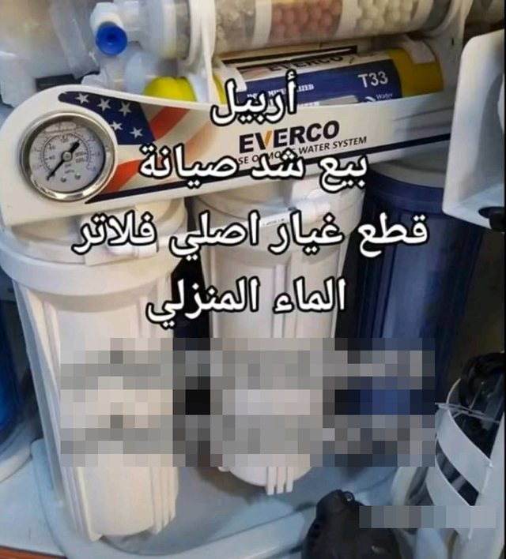 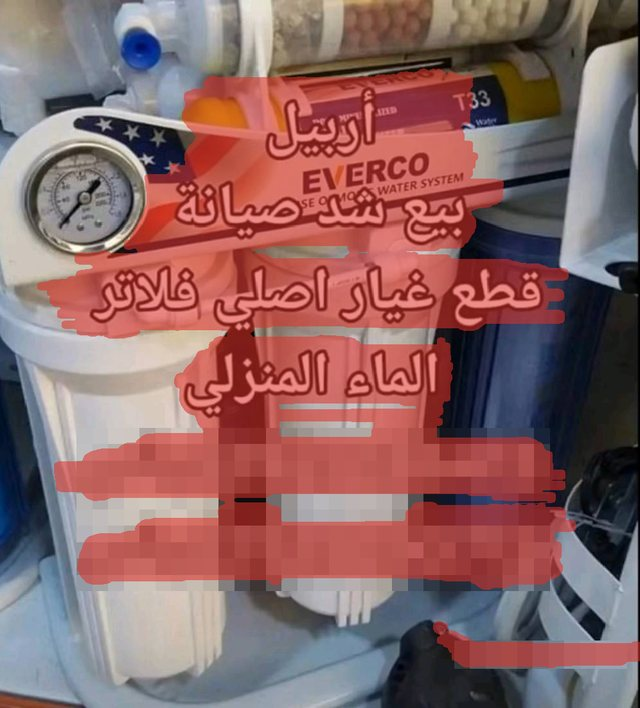 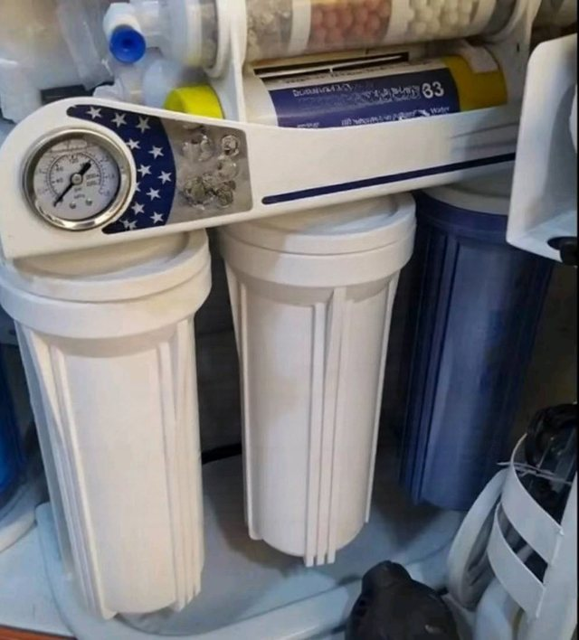</p>

### When the first repaint is enough, and when it isn't

On most photos every check after the first repaint passes (left). On about one in five a later stage has to step in
(right: on a pale sky the first repaint comes back as a flat, grainy rectangle in the chip's shape; the patch check
flags it, the patch fix repaints it, and the smooth sky ships).

<p align="center">
  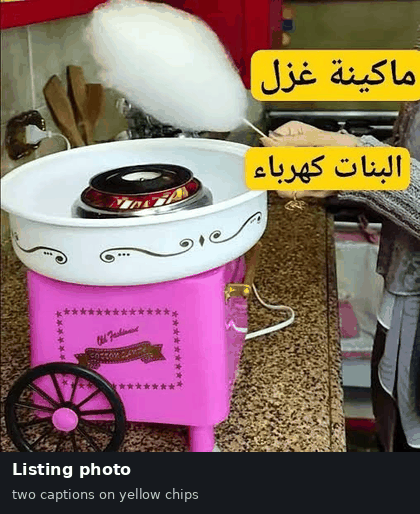
  &nbsp;
  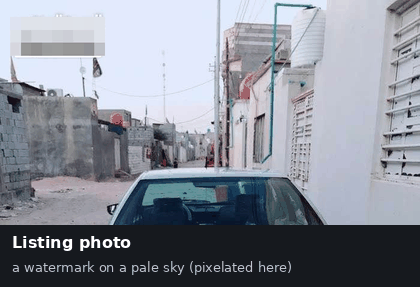
</p>

More photos through every stage: [`photo_stages_2.gif`](docs/media/photo_stages_2.gif),
[`photo_stages_3.gif`](docs/media/photo_stages_3.gif).

## NF4: FLUX in a quarter of the memory

The FLUX transformer is 12 billion parameters, 23 GB in bf16. The eraser keeps it in **NF4**, QLoRA's 4-bit
NormalFloat format: weights become 4-bit codes on levels spaced for normally distributed values, in blocks of 64
with one scale per block, and the scales are quantized again (double quantization). Matrix multiplies still run in
bf16; each block is dequantized on the fly.

```python
# eraser/tl/pipeline/erase.py: the reviewed loader
transformer = FluxTransformer2DModel.from_pretrained(
    FLUX_PATH, subfolder="transformer", torch_dtype=torch.bfloat16,
    quantization_config=BitsAndBytesConfig(load_in_4bit=True, bnb_4bit_quant_type="nf4",
                                           bnb_4bit_compute_dtype=torch.bfloat16, bnb_4bit_use_double_quant=True))
pipe = FluxFillPipeline.from_pretrained(FLUX_PATH, transformer=transformer, ...)
pipe.load_lora_weights(LORA, adapter_name="removal")
```

For deployment the work is done once: [`prepare_models.py`](eraser/prepare_models.py) saves the transformer already
quantized (6.7 GB) and the repaint prompt already encoded, so the 9.5 GB T5 encoder is never loaded on the GPU node.
Outputs are bit-identical to the reviewed run.

| GPU memory, one process | GiB | Repaint time |
|---|---:|---:|
| bf16, live text encoders | 33.7 | 7.9 s |
| bf16, cached prompt | 24.6 | 8.0 s |
| **NF4, cached prompt** | **10.3** | 10.0 s |
| **Whole eraser** (FLUX NF4 + SAM 2.1 + CRAFT + LaMa), peak | **13.4** | |

Same photo, mask and seed, only the precision changed: across the comparison photos the median difference is
5.28/255, and reviewers could not tell the two apart. The difference map is black except inside the repainted chip.
*(original · bf16 · NF4 · difference × 8)*

<p> 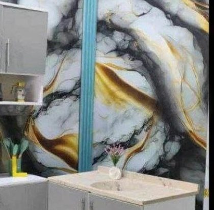 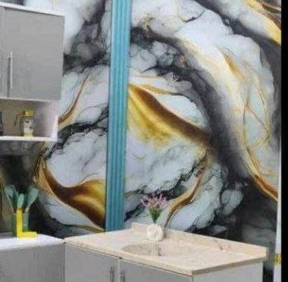 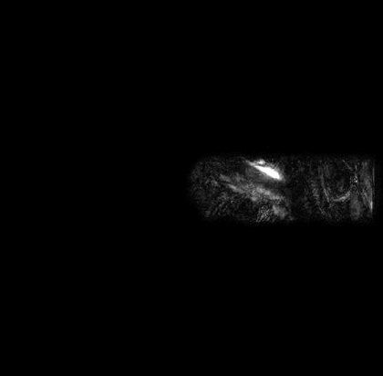</p>

What it buys: the eraser fits a 24 GB card (A5000, 4090; bf16 needs ~30 GB), leaves most of a 48 GB A6000 free, and
starts faster. The catch: bitsandbytes' 4-bit kernels need compute capability ≥ 7.5, so no V100.

## Samples

Before and after, as the shipped eraser returned them (prices, product names, a speech bubble; the "Baby" printed on
the seat belongs to the product and stays):

<p align="center">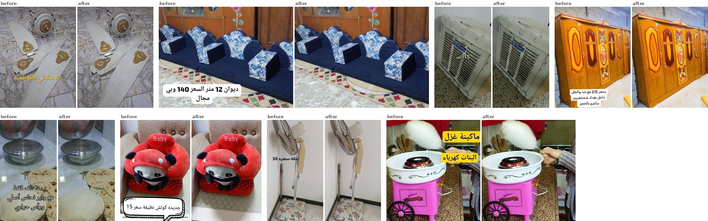</p>

## Results

| Measurement | Result |
|---|---|
| Gate + worker on the 219-photo test set (112 with an overlay), flash-lite | accuracy 92.2%, recall 92.0%, false-positive rate 7.5% |
| The gate's `eligible` vs the existing text prompt (same photos) | same answer on 212 of 219 (96.8%) |
| Human review of the final configuration | 6 of 115 photos marked not good (≈ 95% accepted) |
| Packaged eraser vs the reviewed run | bit-identical on all 113 photos (A5000) |
| A random sample of new listing photos the packaged system erased, judged by eye | **79% clean, 9% minor flaws, 12% bad** |

That sample shows where the work is next. Three quarters of the bad results were **designed graphics** (text cards,
adverts, a banner) that the gate should have left alone: erasing them empties the card. The rest were an emoji over a
plate, erased into an invented plate, and a caption across a vehicle that redrew part of it. Two gate rules would
address most of this: "a designed graphic or text card is never erased" and "a sticker over a plate or a face is
never erased".

Remaining failure classes in review: box misses (faint watermarks), repaint inventions in large holes over objects,
and a faint outline that layer 2 sometimes leaves where an invented object was. Two stages still paint with LaMa
(after FLUX in layer 2, and the plate carve); LaMa was rejected as a visible filler everywhere else, so both are
candidates for replacement.

## Speed, usage and cost on an RTX A6000

| Per erased photo | Median | 90th pct. | Mean |
|---|---:|---:|---:|
| Reviewed pipeline on an RTX A6000, measured (111 photos) | 21.1 s | 39.0 s | 24.7 s |
| Shipped package with the patch fix on an A6000 (A5000 measured × 0.80, the measured ratio) | 20.0 s | 51 s | 25.3 s |
| Shipped package on an RTX A5000, measured | 25.0 s | 64 s | 31.6 s |

That is about **142 erased photos an hour per A6000**, enough for ≈ 2,800 listing photos an hour at 5% overlays; the
other 95% cost one 2-second gate call and no GPU. On the A6000 run layer 2 fired on 22 of 111 photos, the carve on 2,
and the size gate held 4. One copy keeps the GPU ~95% busy, so more throughput means more GPUs, not more copies.

**Usage per 1,000 listing photos** (5% overlay photos, 2.4% text-only photos; token counts from the API's usage
fields):

| | Calls | Input tokens | Output tokens |
|---|---:|---:|---:|
| Gate (photo ≈ 1,080 + prompt 408 tokens, 12 out) | 1,000 | 1.49 M | 12 k |
| Worker (photo + prompt 1,605 tokens, 455 out) | 50 | 135 k | 23 k |
| Existing text prompt (text-only photos) | 24 | 32 k | 3 k |
| **Gemini, total** | **1,074** | **1.65 M** | **38 k** |
| GPU eraser, RTX A6000 | 50 erased photos ≈ 21 GPU-minutes | | |

**Cost overhead**, against what the marketplace pays today for its text call on every photo (= 100):

| | Index | Overhead |
|---|---:|---:|
| Today: the existing text call on every photo | 100 | |
| With removal, Gemini only (flex tier) | 134 | **+34%** |
| With removal, Gemini + an RTX A6000 at a typical rental price | 214 | **+114%** |
| Same, across the range of A6000 rental prices | 178–262 | +78% to +162% |

- Of the new bill, Gemini is 63% and the GPU 37%. On the standard tier both Gemini bills double, so the Gemini
  overhead stays at +34%.
- Within the Gemini part, 84% is input. The gate, paid on every photo, is about 80% of it (the photo alone 55%, its
  prompt 21%, its reply 5%); the worker is 16% and the existing text prompt 3%.
- Sending text-only photos to the existing text prompt instead of the worker keeps the Gemini part 13% lower: on a
  screenshot the worker would box every line (about 1,400 output tokens) for nothing.

## Next steps

The repaint model is general: FLUX.1-Fill with an object-removal LoRA was trained to remove objects, not seller
overlays from listing photos, and most of the later stages exist to catch what that mismatch produces (invented text in
band-shaped holes, flat patches on smooth surfaces, outlines where a chip was).

1. **Gather real data in production.** Keep every photo the system touches: the original, the worker's boxes, each
   stage's output, which checks fired and the reviewer's verdict; the misses and the held photos too, and the many
   listing photos with no overlay at all.
2. **Train a LoRA for this job.** Train a LoRA for FLUX.1-Fill on real listing photos. Real overlays pasted onto
   clean listing photos give before-and-after pairs with an exact answer, and reviewer-accepted outputs add the hard
   real cases.
3. **Shrink the repair stages.** With a repaint that stops inventing text, layer 2, the patch fix and the two LaMa
   passes can shrink or go, which also cuts GPU time. The gate gets the two rules from the results above.

## Running it

```bash
# the eraser alone, on one GPU (models ~33 GB; see eraser/README.md)
cd eraser
bash setup_venv.sh /opt/tl-venv && source /opt/tl-venv/bin/activate
HF_TOKEN=... python download_models.py --models /models
TL_MODELS=/models python prepare_models.py --out /models/prepared
TL_MODELS=/models TL_PREPARED=/models/prepared TL_TOKEN=... python -m eraser.server --port 8080   # listens on 127.0.0.1
```

```python
# the Gemini side: gate, routing, worker, fallbacks (gemini/; needs your own prompt files, see gemini/README.md)
from google import genai
import tl_gemini

client = genai.Client(api_key=API_KEY, http_options=tl_gemini.http_options())
r = tl_gemini.process(client, image_bytes, "image/jpeg")
r["eligible"], r["text"]       # the marketplace's fields (None if every call failed: never a fake "no text")
if r["erase"]:                 # send the photo + r["worker_reply"] to the eraser
    ...
```

## Repository layout

```
docs/
  index.html             the illustrated walkthrough (GitHub Pages)
  media/                 every picture and animation on it, cut from real runs
gemini/
  README.md              what each prompt asks and returns, usage per call, prompt history
  tl_gemini.py           the calls, routing, retries and fallbacks, exactly as tested
eraser/                  the GPU eraser as a deployable service
  eraser/                engine, HTTP server, batch CLI, client example
  tl/                    the reviewed pipeline code (mask, FLUX erase, layer 2, patch fix, carve; config with the
                         reason for every constant)
  prepare_models.py      one-time NF4 transformer + cached prompt
  download_models.py     pinned, checksummed model files
  tests/, bench_samples/ service smoke test, speed benchmark, output check
  Dockerfile, requirements.txt, setup_venv.sh
```

## What was tried and rejected

The negative results were expensive and are the most transferable part of the work.

| Attempt | Why it failed |
|---|---|
| A text detector as the decider (CRAFT, Grounding DINO) | fire on 85/86 and 72/86 photos with no overlay at all |
| A halo (extra margin) around the mask | it was hiding a compositing bug; with the bug fixed, the halo only gave FLUX more room to invent |
| Gaussian feather of the mask | eats inward and leaves a faint ghost of the text in its original colour (6–8% of the original survived); replaced by an outward-only feather |
| LaMa as the filler, the repairer or a draft for FLUX | blur, smears, dark gradients: rejected in review for anything that paints visible pixels. The reviewed code still uses it after FLUX in layer 2 and in the plate carve; both are flagged for replacement |
| Klein, FLUX.2-dev | invents text; FLUX.2 is 35× slower |
| Trimmed worker replies | boxed worse; the reply stays as it is |
| One combined Gemini call | drops screenshot text |
| Lines-first worker prompts | missed more regions; one erased a logo together with a plate |
| Disguised repaint pasted through the feather | changed the photo outside the mask (up to 0.77% of the frame); the rule since: a fix may never change the photo beyond the intended mask |
| Re-rolling seeds, CRAFT-judged rerolls | never fix invention: FLUX paints the carrier back because the hole has the carrier's shape |
| Lower media resolution, a text-copying gate | ruled out: they may hurt the system |
| CRAFT's score as a quality metric | anti-correlates with the eye; it cannot see faint ghosts. Judge by eye at full size |

## Privacy and licences

The photographs are real listing photos. Only the pictures in `docs/media/` are published, each checked frame by frame:
phone numbers and a marketplace watermark are pixelated, and crops leave out faces and licence plates. The prompt
texts, the test photos, the labels and every experiment output stay private. Gemini calls send only pixels: no
listing ids, file names or paths.

**FLUX.1 Fill [dev] is licensed for non-commercial, non-production use.** Commercial use needs a licence from Black
Forest Labs. SAM 2.1 and LaMa are Apache-2.0, CRAFT and the object-removal LoRA are MIT.

## History: the first pipeline (August 2026)

The first end-to-end version used one Gemini call to box overlays, a SAM2 ∪ change-region mask with a +15 px halo,
and FLUX.1-Fill with the same removal LoRA. Before it, an SDXL + LaMa pipeline passed human review on 64 of 89 photos
(71.9%), and its failures tracked mask coverage (95% pass at 2–5% of the frame, 0% above 20%). Two lessons from those
rounds still shape the design: the inpainter needs a positive prompt ("plain empty surface…") or its prior writes
text into banner-shaped holes, and mask size is the strongest predictor of failure. The halo was later found to be
hiding the feather bug and went to 0.
