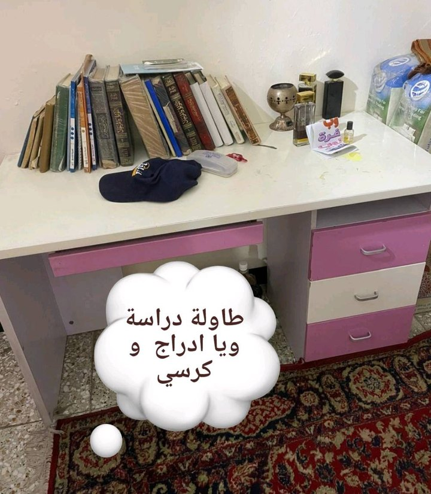
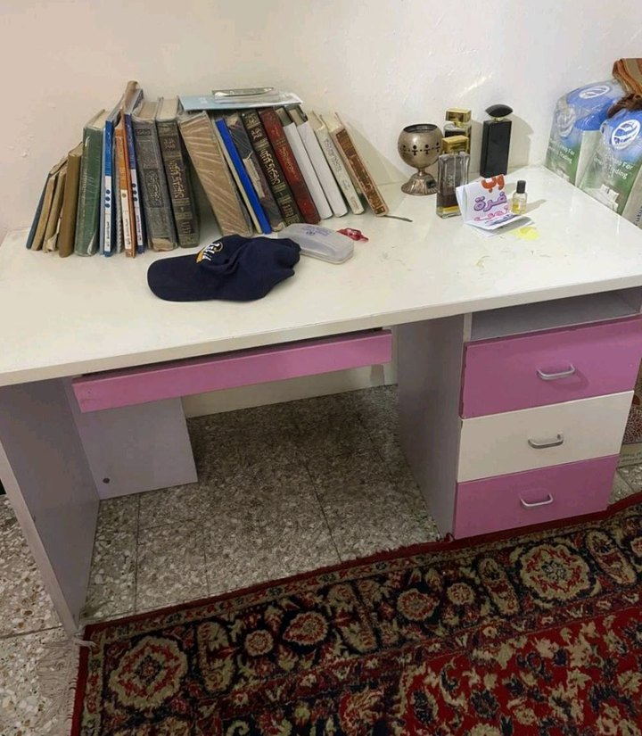
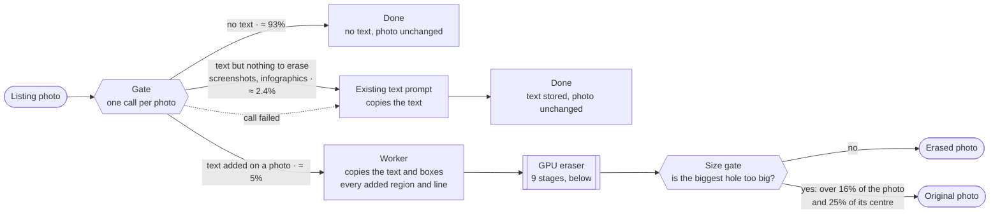
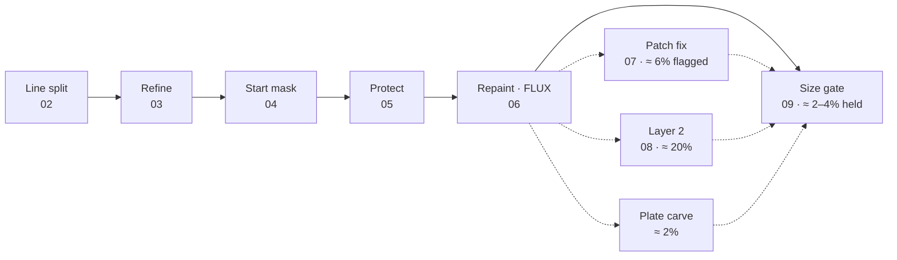

# Erasing the text sellers type over their photos

Marketplace sellers burn prices, phone numbers and captions into their listing photos. This pipeline finds what was
added, repaints what it covers, and leaves the photograph and its real-world writing alone.

**Interactive version (drag-to-compare, diagrams): https://aminalmasi.github.io/text-overlay-removal/**

<p align="center">
  
  &nbsp;
  
</p>
<p align="center"><sub>Before and after. Real output of the shipped eraser.</sub></p>

| **92%** | **6 / 115** | **21 s** | **13.4 GiB** |
|:---:|:---:|:---:|:---:|
| gate + worker accuracy on a 219-photo labelled test set | photos flagged in the final human review | median GPU time per erased photo on an RTX A6000 | peak GPU memory for the whole eraser, with FLUX in NF4 |

Contents: [The problem](#the-problem) · [The system](#the-system) · [What the model is asked](#what-the-model-is-asked) ·
[Step by step](#step-by-step) · [NF4](#nf4-flux-in-a-quarter-of-the-memory) ·
[Speed, usage and cost](#speed-usage-and-cost-on-an-rtx-a6000) · [Results](#results) · [Next](#next-real-data-then-a-lora-of-its-own) ·
[What didn't work](#what-didnt-work) · [For developers](#for-developers)

---

## The problem

**The overlay is the image now.** Listing photos arrive with the price, a phone number, the shop's name or an app
watermark typed straight onto the pixels. There is no layered original to go back to and the goods were often sold
long ago, so the only way to a clean photo is to reconstruct what the text covers. Roughly one listing photo in twenty
carries text added on top of a real photograph.

- **Not all text is an overlay.** Goods have writing on them: labels, packaging, shop signs, licence plates, screens.
  A text detector cannot tell the two apart. CRAFT fires on 85 of 86 photos that have no overlay at all, so the
  decision has to come from a model that understands the picture.
- **The overlay hides its own extent.** Text usually sits on a chip, a band or a translucent panel. A mask drawn
  around the letters stops inside that carrier and leaves a rim; one drawn too wide repaints the product.
- **Repainting invites invention.** An inpainting model fills a hole with what it expects to see there. Given a
  banner-shaped hole on a marketplace photo, it expects a banner, and paints new letters into it.

<p align="center"></p>

*Before and after, eight listings. Prices, product names and a speech bubble, in Arabic and Kurdish, with Eastern and
Western digits. The "Baby" printed on the seat belongs to the product, so it stays. Outputs of the shipped eraser.*

## The system

**Two cheap questions, then the GPU.** Every photo gets one call to Gemini 3.5 Flash-Lite, the **gate**. Its whole
answer is about 12 tokens: is there text worth storing, and was text added on top of a real photograph? Only photos with
an overlay go on to the **worker**, which copies the text and boxes every added region and line, and then to the GPU
**eraser**. Photos whose text is the content (screenshots, infographics, posters) go to the marketplace's existing text
prompt and are never erased.



*Routing, with the expected share of photos on each path. Every call: Gemini 3.5 Flash-Lite, temperature 0, thinking
low, strict JSON schema, flex tier. If a call fails, the photo falls back to the marketplace's existing call; if every
call fails, the fields come back unknown, never as a fake "no text".*

## What the model is asked

**Two prompts, and what they return.** The prompt texts stay private. What matters for the pipeline is what each prompt
asks and the fields it returns, because the eraser is built on those fields.

**Gate: two questions about every photo.**
- `eligible` (true or false): does the picture carry *digital* text? That means overlays such as prices, phone numbers
  and links, infographics, and screenshots of specification pages or messages. Writing on physical things never
  counts: printing, logos, stickers, licence plates, documents beside the product. A brand printed on a box is out;
  the same brand typed on as an overlay is in. The field keeps the meaning the marketplace already stores, so the gate
  can take over that call.
- `removal` (0 or 1): was something added *on top of a real photograph*, so that removing it leaves a hole to
  reconstruct? The prompt lists what is 0 even though it carries text: text on its own band beside the photos, posters
  and adverts built around their words, cut-out product shots, screenshots, and app buttons and counters. Two rules
  settle the hard cases: "the amount of writing is not evidence" and "when unsure, 0".

```json
{"eligible": true, "removal": 1}
```

**Worker: the text, and a box for every added mark.** Runs only when `removal` is 1. It copies the added text verbatim,
in reading order, without translating or guessing, and returns one region per added mark. The rules that took longest
to get right:
- **One region is one mark.** A logo and its words together; emoji at a line's ends belong to that line; lines on one
  carrier are one region; lines with photograph between them are separate boxes.
- **The box covers the carrier** (chip, band, bubble, scrim, glow, shadow) out to its edge, not just the letters.
- **Protect what must stay.** Plates, serial numbers, screens, meters and a device's own display come back as regions
  with `physically_in_scene: true`.
- **Self-check.** Every copied line that lies on the photo must sit inside some box.

| Worker field | What it holds | What the eraser does with it |
|---|---|---|
| `box_2d` | the region with its carrier, [ymin, xmin, ymax, xmax] on a 0–1000 grid | prompts SAM2; bounds the mask |
| `text_box_2d` | the readable content alone | where layer 2 looks for leftover text |
| `line_boxes` | one box per line | splits bare text into lines (stage 02) |
| `carrier_present`, `carrier_kind`, `carrier_opacity` | is there a chip, band, bubble or scrim; which; can the photo be seen through it | bare text is split and refined line by line; a carrier is erased whole |
| `kind` | text, emoji/symbol, logo/watermark, sticker/badge, mixed | only plain text is snapped to CRAFT's words; emoji regions are widened |
| `physically_in_scene` | false: composited on afterwards; true: part of the scene, or unsure | erase (false) or protect (true); a missing value means protect |
| `text`, `confidence` | the region's text verbatim; certain, probable or possible | stored and logged, not used to erase |

Photos with text but nothing to erase go to the marketplace's existing text prompt, unchanged, which returns `eligible`
and `text`; it is also the fallback when a call fails. Three shorter worker reply formats were tested and all boxed
worse, so the reply keeps its field names and coordinates (about 455 tokens). The full description of both prompts,
token usage per call and the prompt history: [`gemini/README.md`](gemini/README.md).

## Step by step

**Every stage is there because a photo needed it.** The eraser holds FLUX.1-Fill with an object-removal LoRA, SAM 2.1,
CRAFT and LaMa on one GPU. Each stage below was added after a specific failure on real listings, and each comes with the
photo that showed the problem: the pipeline without the stage, then with it. Red = mask, magenta = worker box,
green = protected writing.



*The eraser, in order: solid arrows always run, dashed ones only when a check fires. Frequencies from the A6000 run on
111 reviewed photos and the A5000 package benchmark.*

### 01 · Gate: decide whether anything should be erased
<sub>Gemini 3.5 Flash-Lite · ~1,500 tokens in, 12 out · one call on every photo</sub>

**Why it's there:** most text should not be erased. An advert built around its words has nothing underneath to
restore, and a shop sign or a printed label belongs to the photo. Only text added on top of a real photograph leaves a
hole worth filling. The three photos below get three different answers; each is the gate's own reply from the test
set. On the 219-photo test set, gate plus worker reach 92.2% accuracy with a 7.5% false-positive rate.

<p>  </p>

*a price on the photo: eligible, removal 1 → erase · an advert built on its words: eligible, removal 0 → copy the text,
keep the picture · a real sign only (number pixelated): not eligible, removal 0 → nothing to do*

### 02 · Worker boxes, split into lines
<sub>box_2d = [ymin, xmin, ymax, xmax] on a 0–1000 grid · one box per region and per line</sub>

**Why it's there:** when the worker draws one box around three lines, SAM2 is asked to outline "the object in this
box" and returns the gate behind the text. The mask grows to the whole gate, and FLUX replaces the gate with a wall.
Splitting bare text into its line boxes keeps SAM2 on the letters.

<p>    </p>

*original · one box: mask · gate becomes a wall · line boxes: mask · gate kept*

### 03 · Refine and align the boxes
<sub>CRAFT word map · snap edges, widen emoji lines, re-align shifted replies</sub>

**Why it's there:** Gemini's coordinates drift. On 3–8% of regions a box is about one line off, and sometimes a whole
reply is shifted half a line down. Edges that cut through a word leave its top behind. The refine step snaps each box
onto the words CRAFT detects, using the box as the search area.

<p>    </p>

*original · boxes as returned · letters left behind · snapped to the words · clean*

### 04 · Starting mask: SAM2 ∪ change region ∪ CRAFT strokes
<sub>SAM 2.1 large, box prompts · alpha-matte change region · CRAFT character scores</sub>

**Why it's there:** SAM2 finds the shape of a chip or band, and the change region catches translucent panels, but thin
white strokes on a busy brick wall slip through both. What they miss shows up as a faint line of letters in the result.
Adding CRAFT's character strokes inside the boxes closes the gap.

<p>    </p>

*original (phone pixelated) · SAM2 + change region · a ghost line survives · + CRAFT strokes · clean*

### 05 · Protect real-world writing, close the gaps
<sub>worker flag physically_in_scene · protected areas cut out of the stencil · rows between lines closed</sub>

**Why it's there:** the product's own writing is part of the goods. The worker marks a scale's display, a sign, a label
or a licence plate as real-world, and those areas are cut out of the stencil and restored after every repaint. Gaps
between caption lines are closed, so no thin strip of old background survives between two repainted lines.

<p>  </p>

*green: display, protected · stencil: caption only · display untouched*

### 06 · Repaint with FLUX.1-Fill, blended outward only
<sub>FLUX.1-Fill-dev · objectRemoval LoRA r32 at 1.0 · guidance 30 · 30 steps · NF4 · crop long edge 768–1280 px</sub>

**Why it's there:** FLUX.1-Fill is the only FLUX variant with a real inpainting input (384 input channels: noise,
masked image and mask). The removal LoRA is the restraint dial, and a positive prompt ("plain empty surface, seamless
continuation…") gives guidance something to pull toward, because with an empty prompt the model's prior for a
banner-shaped hole is more text.

The blend matters as much as the model. A Gaussian-feathered mask also softens inward, so thin strokes never reach full
strength and a faint copy of the text survives in its original colour: 6–8% of the original showed through inside the
mask. Taking the brighter of the mask and its blur keeps the inside at full strength and puts all of the soft edge
outside.

<p>  </p>

*original · Gaussian feather: red ghost · outward-only feather*

### 07 · Patch fix for flat surfaces
<sub>flags grain + a seam on smooth surroundings · 2 repaints through a disguised hole · kept only if the score drops ≥ 10%</sub>

**Why it's there:** on smooth sky or a plain wall, the first repaint can come back as a grainy rectangle in the exact
shape of the watermark chip. The check finds it, repaints just that patch through a hole with a randomised edge (so
FLUX doesn't see the chip's shape), and pastes the result strictly inside the original mask.

<p>  </p>

*original (watermark pixelated) · first repaint: a noise patch · after the patch fix*

### 08 · Layer 2: remove text the repaint invented
<sub>CRAFT inside the hole → SAM2 outlines what was invented → repaint inside the stencil · ran on 22 of 111 photos</sub>

**Why it's there:** FLUX fills a hole with what it expects to see there. Over an oven's dial it expects dial numbers,
and it writes new ones into the hole where the caption was. CRAFT finds text inside the repainted hole, SAM2 extends it
to the whole invented object, and that area is repainted again, strictly inside the original stencil.

<p>  </p>

*original (phone pixelated) · first repaint writes dial numbers · after layer 2*

### 09 · Size gate: ship the original when the hole is too big
<sub>hold if the largest hole covers > 16% of the photo and > 25% of its centre · held 4 of 111</sub>

**Why it's there:** mask size was the strongest predictor of failure from the first human review on (95% of photos
passed at 2–5% of the frame, none above 20%). When most of a product would have to be invented, the honest answer is
the untouched photo. Here six lines of text cover most of a water-filter system. The repaint looks plausible at a
glance, but every housing in it was invented, so the eraser ships the original.

<p>  </p>

*original (numbers pixelated) · hole: 39% of the photo, 83% of its centre · the repaint: invented filters, never shipped*

### When the first repaint is enough, and when it isn't

On most photos the checks after the first repaint all pass and nothing else runs. On about one in five, a later stage
has to step in. Both animations are real runs, frame by frame.

<p align="center">
  
  &nbsp;
  
</p>

*Enough (left): two captions on chips, mask 11.3% of the photo, one repaint, no patch, no leftover text. Shipped.
Not enough (right): a watermark sits on a pale sky. The first repaint comes back as a flat, grainy rectangle in the
chip's shape; the patch check flags it, the patch is repainted through a disguised hole, and the smooth sky ships.*

More photos through every stage: [`stages_desk.gif`](docs/media/stages_desk.gif),
[`photo_stages_2.gif`](docs/media/photo_stages_2.gif), [`photo_stages_3.gif`](docs/media/photo_stages_3.gif).

## NF4: FLUX in a quarter of the memory

The FLUX transformer is 12 billion parameters, 23 GB in bf16. The eraser keeps it in **NF4**, the 4-bit NormalFloat
format from QLoRA. Weights are stored as 4-bit codes on levels spaced for normally distributed values, in blocks of 64
with one scale per block, and those scales are quantized again (double quantization). Matrix multiplies still run in
bf16: each block is dequantized on the fly.

```python
# eraser/tl/pipeline/erase.py: the reviewed loader
transformer = FluxTransformer2DModel.from_pretrained(
    FLUX_PATH, subfolder="transformer", torch_dtype=torch.bfloat16,
    quantization_config=BitsAndBytesConfig(load_in_4bit=True, bnb_4bit_quant_type="nf4",
                                           bnb_4bit_compute_dtype=torch.bfloat16, bnb_4bit_use_double_quant=True))
pipe = FluxFillPipeline.from_pretrained(FLUX_PATH, transformer=transformer, ...)
pipe.load_lora_weights(LORA, adapter_name="removal")
```

For deployment the work is done once, ahead of time. [`prepare_models.py`](eraser/prepare_models.py) saves the
transformer already quantized (6.7 GB on disk) and the repaint prompt already encoded. The prompt never changes, so the
9.5 GB T5 text encoder is never loaded on the GPU node at all. Outputs are bit-identical to the reviewed run.

| GPU memory, one process | GiB | Repaint time |
|---|---:|---:|
| bf16, live text encoders | 33.7 | 7.9 s |
| bf16, cached prompt | 24.6 | 8.0 s |
| **NF4, cached prompt** | **10.3** | 10.0 s |
| **Whole eraser** (FLUX NF4 + SAM 2.1 + CRAFT + LaMa), peak | **13.4** | |

**What NF4 changes in the picture.** Same photo, same mask, same seed; only the precision differs. Across the
comparison photos the median per-pixel difference is 5.28 levels out of 255, and side-by-side reviews could not tell
which was which. The difference map, amplified 8×, is black everywhere except inside the repainted price chip, where
the two differ only in the fine texture of the marble.

<p>   </p>

*original · bf16 · NF4 · |bf16 − NF4| × 8*

**What it buys in use.**
- **Cheaper cards.** The whole eraser fits on a 24 GB RTX A5000 or 4090; bf16 needs about 30 GB and a 48 GB card.
- **Room on an A6000.** At 13.4 GiB one process leaves most of a 48 GB card free. A second copy adds at most about
  10% throughput, because one copy already keeps the GPU about 95% busy.
- **Faster start.** Reading 6.7 GB of prepared weights instead of 23 GB plus a 9.5 GB encoder, with no quantization
  step at start-up.
- **The catch:** bitsandbytes 4-bit kernels need compute capability 7.5 or newer, so V100s are out.

## Speed, usage and cost on an RTX A6000

Measured on one RTX A6000 (48 GB) on 111 reviewed photos. The FLUX repaint is almost all of the time; everything else
is under a second unless layer 2 or the patch fix runs.

| Per erased photo, RTX A6000 | Median | 90th pct. | Mean |
|---|---:|---:|---:|
| Reviewed pipeline, measured (111 photos) | 21.1 s | 39.0 s | 24.7 s |
| Shipped package, with the patch fix (A5000 measured × 0.80) | 20.0 s | 51 s | 25.3 s |
| Shipped package on an RTX A5000, measured | 25.0 s | 64 s | 31.6 s |

That is about **142 erased photos an hour per A6000**, enough for about 2,800 listing photos an hour when 5% need
erasing. The other 95% cost one gate call of about 2 seconds and no GPU at all. End to end, an erased photo takes about
24 s: gate 2.1 s, worker 1.7 s, then the GPU.

**Usage per 1,000 listing photos**, at 5% overlay photos and 2.4% text-only photos (the expected mix; token counts are
the API's own usage fields from the test runs):

| Per 1,000 listing photos | Calls | Input tokens | Output tokens |
|---|---:|---:|---:|
| Gate (photo ≈ 1,080 + prompt 408 tokens) | 1,000 | 1.49 M | 12 k |
| Worker (photo + prompt 1,605 tokens) | 50 | 135 k | 23 k |
| Existing text prompt (text-only photos) | 24 | 32 k | 3 k |
| **Gemini, total** | **1,074** | **1.65 M** | **38 k** |
| GPU eraser, RTX A6000 | 50 erased photos ≈ 21 GPU-minutes | | |

**Cost overhead**, measured against what the marketplace pays today for its text-extraction call on every photo, set
to 100. One gate call now runs on every photo instead, and the worker and the old text prompt each run on a few percent
of photos.

| | Index | Overhead |
|---|---:|---:|
| Today: the existing text call on every photo | 100 | |
| With removal, Gemini only (flex tier) | 134 | **+34%** |
| With removal, Gemini + an RTX A6000 at a typical rental price | 214 | **+114%** |
| Same, across the range of A6000 rental prices | 178–262 | +78% to +162% |

- The Gemini side adds a third; on the standard tier both bills double, so that overhead stays at +34%. Of the new
  bill, Gemini is 63% and the GPU 37%.
- **Where the Gemini part goes:** the gate's photo 55%, its prompt 21%, its reply 5% (so the gate, paid on every
  photo, is about 80%); the worker 16%; the existing text prompt 3%. 84% of it is input and 16% output, though output
  tokens cost about 8× more: the gate answers in 12 tokens.
- Sending text-only photos to the existing text prompt instead of the worker keeps the Gemini part 13% lower; on a
  screenshot the worker would box every line (about 1,400 output tokens) only for the boxes to be thrown away.

## Results

**What it got right, and what it still gets wrong.**

| Measurement | Result |
|---|---|
| Gate + worker, 219 labelled photos (112 with an overlay) | accuracy 92.2%, recall 92.0%, false positives 7.5% |
| Gate's `eligible` answer vs the existing text prompt | same on 212 of 219 photos |
| Human review of the final configuration | 6 of 115 photos flagged (≈ 95% accepted) |
| Shipped package vs the reviewed run | bit-identical on all 113 photos |
| A random sample of new listing photos the packaged system erased, judged by eye | 79% clean, 9% minor flaws, 12% bad |

That sample points to the next work. Three quarters of the bad results were designed graphics, such as text cards and
adverts, that the gate should have left alone (step 01). The rest were an emoji over a licence plate, erased into an
invented plate, and a caption across a vehicle that redrew part of it. Two gate rules would cover most of it: a
designed graphic is never erased, and a sticker over a plate or a face is never erased.

On the eraser side, layer 2 sometimes leaves a faint outline where an invented object was, and two late stages (after
FLUX in layer 2, and the plate carve) still paint with LaMa. Both are the next stages to replace.

## Next: real data, then a LoRA of its own

The repaint model is general. FLUX.1-Fill with an object-removal LoRA was trained to remove objects, not seller
overlays from listing photos, and most of the later stages exist to catch what that mismatch produces: invented text in
band-shaped holes, flat patches on smooth surfaces, outlines where a chip was.

1. **Gather real data in production.** Keep every photo the system touches: the original, the worker's boxes, each
   stage's output, which checks fired and the reviewer's verdict. Keep the misses and the held photos too, and the many
   listing photos that carry no overlay at all.
2. **Train a LoRA for this job.** Train a LoRA for FLUX.1-Fill on real listing photos. Real overlays pasted onto clean
   listing photos give before-and-after pairs with an exact answer, and reviewer-accepted outputs add the hard real
   cases.
3. **Shrink the repair stages.** With a repaint that stops inventing text, layer 2, the patch fix and the two LaMa
   passes can shrink or go, which also cuts GPU time. The gate gets its two new rules from the sample above.

## What didn't work

**The expensive negatives.**

| Tried | Why it was dropped |
|---|---|
| A text detector deciding what to erase | CRAFT fires on 85 of 86 photos with no overlay; Grounding DINO on 72 |
| A safety margin (halo) around the mask | it was hiding the feather bug; once fixed, extra margin only gave FLUX more room to invent |
| LaMa as the filler or as a draft for FLUX | blur and smears that FLUX then keeps. Two late stages still use it and are flagged for replacement |
| FLUX.2-dev, FLUX Klein | invent text; FLUX.2 is 35× slower |
| Shorter worker replies, one combined call | boxed worse, or dropped screenshot text |
| A disguised repaint pasted through the feather | changed the photo outside the mask (up to 0.77% of the frame); the rule since: a fix may never change the photo beyond the intended mask |
| Reseeding until the result looks clean | never fixes invention: the hole's shape is the cause, not the seed |
| Judging quality with CRAFT scores | blind to faint ghosts; every decision here was made by eye at full size |

**Built with:** Gemini 3.5 Flash-Lite (gate and worker) · FLUX.1-Fill-dev with an object-removal LoRA, NF4 via
bitsandbytes · SAM 2.1 · CRAFT · LaMa · diffusers and PyTorch · an HTTP eraser service with a batch CLI, a benchmark and
a Docker image.

---

## For developers

### Running it

```bash
# the eraser alone, on one GPU (models ~33 GB; see eraser/README.md)
cd eraser
bash setup_venv.sh /opt/tl-venv && source /opt/tl-venv/bin/activate
HF_TOKEN=... python download_models.py --models /models
TL_MODELS=/models python prepare_models.py --out /models/prepared
TL_MODELS=/models TL_PREPARED=/models/prepared TL_TOKEN=... python -m eraser.server --port 8080   # listens on 127.0.0.1
```

```python
# the Gemini side: gate, routing, worker, fallbacks (gemini/; needs your own prompt files, see gemini/README.md)
from google import genai
import tl_gemini

client = genai.Client(api_key=API_KEY, http_options=tl_gemini.http_options())
r = tl_gemini.process(client, image_bytes, "image/jpeg")
r["eligible"], r["text"]       # the marketplace's fields (None if every call failed: never a fake "no text")
if r["erase"]:                 # send the photo + r["worker_reply"] to the eraser
    ...
```

### Repository layout

```
docs/
  index.html             the illustrated walkthrough (GitHub Pages)
  media/                 every picture and animation on it, cut from real runs
gemini/
  README.md              what each prompt asks and returns, usage per call, prompt history
  tl_gemini.py           the calls, routing, retries and fallbacks, exactly as tested
eraser/                  the GPU eraser as a deployable service
  eraser/                engine, HTTP server, batch CLI, client example
  tl/                    the reviewed pipeline code (mask, FLUX erase, layer 2, patch fix, carve; config with the
                         reason for every constant)
  prepare_models.py      one-time NF4 transformer + cached prompt
  download_models.py     pinned, checksummed model files
  tests/, bench_samples/ service smoke test, speed benchmark, output check
  Dockerfile, requirements.txt, setup_venv.sh
```

Every number and threshold in the eraser was fixed by a measurement;
[`eraser/tl/pipeline/config.py`](eraser/tl/pipeline/config.py) and the files under [`eraser/tl/`](eraser/tl) carry
the reasons as comments.

### Privacy and licences

The photographs are real listing photos. Only the pictures in `docs/media/` are published, each checked frame by frame:
phone numbers, an account name and a marketplace watermark are pixelated, and crops leave out faces and licence plates.
The prompt texts, the test photos, the labels and every experiment output stay private. Gemini calls send only pixels:
no listing ids, file names or paths.

**FLUX.1 Fill [dev] is licensed for non-commercial, non-production use.** Commercial use needs a licence from Black
Forest Labs. SAM 2.1 and LaMa are Apache-2.0, CRAFT and the object-removal LoRA are MIT.

### History: the first pipeline (August 2026)

The first end-to-end version used one Gemini call to box overlays, a SAM2 ∪ change-region mask with a +15 px halo, and
FLUX.1-Fill with the same removal LoRA. Before it, an SDXL + LaMa pipeline passed human review on 64 of 89 photos
(71.9%), and its failures tracked mask coverage (95% pass at 2–5% of the frame, 0% above 20%). Two lessons from those
rounds still shape the design: the inpainter needs a positive prompt ("plain empty surface…") or its prior writes text
into banner-shaped holes, and mask size is the strongest predictor of failure. The halo was later found to be hiding the
feather bug and went to 0.
